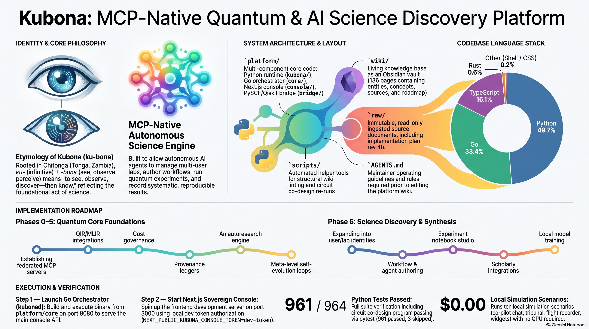

<div align="center">


# Kubona

### *See, observe, discover — then know.*

**An open-source quantum-computing and AI-enhanced science discovery platform for autonomous AI agents, with an MCP tool layer (6 servers, 36 tools over stdio).**

<p align="center">
  <a href="LICENSE"></a>
  <a href="https://creativecommons.org/licenses/by/4.0/"></a>
  <a href="platform/kubona/"></a>
  <a href="platform/core/"></a>
  <a href="platform/console/"></a>
  <a href="platform/tests/"></a>
  <a href="wiki/concepts/local-simulation-test-scenarios.md"></a>
  <a href="wiki/"></a>
  <a href="wiki/questions.md"></a>
  <a href="https://www.linkedin.com/in/mainza-kangombe-6214295"></a>
</p>

</div>

---

> **“To see is the founding act of science: observe, measure, record, understand.”**  
> **Kubona** draws its name from the Chitonga (*Tonga, Zambia*) infinitive: **ku-** (infinitive prefix) + **-bona** (*to see, observe, perceive*). Kubona systematically surfaces quantum phenomena, orchestrates autonomous agent experiments, and records immutable, reproducible findings.

> [!NOTE]
> **Active Research Platform**: Kubona is under active development. APIs, agent protocols, and the sovereign console evolve rapidly. See [`wiki/roadmap.md`](wiki/roadmap.md) for phased milestones and [`wiki/log.md`](wiki/log.md) for the latest research log.

---

## 📽️ Deep Dive: The AI Quantum Bridge

Watch the architectural walkthrough of how autonomous AI agents interface with the sovereign Go orchestrator and quantum execution runtime inside the Kubona stack:

<div align="center">
  <a href="https://youtu.be/Clo0PAk7Oj0" target="_blank">
    
  </a>
  <p><em>▶️ <strong><a href="https://youtu.be/Clo0PAk7Oj0">Watch: Architecting the AI Quantum Bridge Inside the Kubona Stack</a></strong> (Milimo Quantum)</em></p>
</div>

---

## 🗺️ Platform Architecture & Overview

<div align="center">
  <a href="assets/misc/Kubona_Platform_Overview_Infographic.png">
    
  </a>
  <p><em>System topology, language breakdown, execution pipeline, and verification gates. Click image to expand.</em></p>
</div>

### 📑 Executive Presentation Deck
Explore the comprehensive 10-slide architectural deck:
👉 **[Download / View the Kubona Quantum & AI Discovery Platform Deck (PDF)](assets/misc/Kubona_Quantum_AI_Discovery_Platform.pdf)**
*(Features: epistemic scientific loops, agentic autonomy pillars, polyglot system topology, evaluator-guided circuit co-design, and $0.00 local simulation).*

---

## 🔬 The Epistemic Scientific Loop

Kubona structures scientific inquiry for autonomous agents across four deterministic stages:

```
  ┌──────────────┐       ┌──────────────┐       ┌──────────────┐       ┌──────────────┐
  │  1. Observe  │ ───►  │  2. Measure  │ ───►  │  3. Record   │ ───►  │4. Understand │
  └──────────────┘       └──────────────┘       └──────────────┘       └──────────────┘
  Surface quantum        Execute agent-         Log tamper-proof       Synthesize
  phenomena              directed algorithms    provenance ledger      reproducible
  systematically.        (VQE, QAOA, circuits). (SQLite WAL / edge).   discoveries.
```

- **Agentic Autonomy**: Sovereign multi-user labs, user- and agent-authored workflows, and meta-level self-evolution loops.
- **Quantum Core**: QIR/MLIR execution pipelines, PySCF/Qiskit bridge, evaluator-guided circuit co-design, and built-in cost governance.
- **Science Discovery**: Autonomous autoresearch engine, interactive experiment notebooks, and an organized results studio.

### Verifiable Tool Grounding (MCP Layer)

Every epistemic stage translates into concrete, deterministic tools exposed through the MCP layer (6 federated servers, 36 tools over stdio, digest-pinned in [`platform/contracts/mcp-catalog.json`](platform/contracts/mcp-catalog.json)):

* **Observe & Measure**: `execution` server (circuit execution, VQE sweeps, state-vector simulation, hardware capability probes).
* **Synthesize & Optimize**: `compiler` server (pass portfolio, QIR/OpenQASM3 transpilation, circuit co-design verification).
* **Record & Attest**: `provenance` server (immutable SQLite WAL ledger, Merkle audit chains, confidentiality lattice labels).
* **Govern & Gate**: `cost` & `control` servers (spend mandates, pre-flight budget checks, tenant isolation, operator approval cards).
* **Navigate the World**: `world` server (agents traverse the same observatory as humans — `look`, `probe`, `anchor`, `gaze`, `summon`, `handoff`, `replay` — through governed, ledger-sealed rails; estimates only, agents never spend or dispatch).

### Observatory: See the Science (3D Representation Layer)

The console's Spatial Canvas ships a game-like, diegetic **Observatory** — the same platform, watched instead of read:

* **Tier 1 — Walkable Lab ($0.00, air-gap safe):** a local Three.js potential-energy terrain bound to the PySCF FCI anchor, with a hover/click inspection probe, a procedural pavilion frame, and a calm-technology Attention Director (interrupt hierarchy, ambient sound, CheckInStrip pill).
* **Tier 2 — Atlas Lens (opt-in, metered):** World Labs Marble 2 renders an illustrative architectural skin over exact local geometry — snapshot posing, depth-conditioned chisel from an offscreen-encoded EXR, `promptUsed` receipts. Every dispatch reserves $0.50 against the session spend cap, requires operator auth, and fails closed without imagery (no stock photos, ever).
* **Vault pre-registration:** seal μ ± σ expectations before compute, evaluate measurements after — standardized surprise (z), Brier-scored 3σ containment, ghost-contour binding, both stages ledger-sealed.

Design blueprint and full audit trail: [`wiki/concepts/observatory-spatial-representation-layer.md`](wiki/concepts/observatory-spatial-representation-layer.md) and [`wiki/concepts/observatory-lens-audit-2026-10-23.md`](wiki/concepts/observatory-lens-audit-2026-10-23.md). Live Atlas calls are opt-in and metered; everything else in this README runs at $0.00.

---

## 🧱 Design Principles

Kubona runs on three rules. They apply to the code, the agents, and this README.

**1. Receipts don't lie.** Every spend decision, every evaluation result, every agent action is written to a sealed, tamper-proof ledger. If it isn't in the ledger, it didn't happen. Measurements are measurements. Guesses are labeled as guesses.

**2. Refuse loudly.** No silent defaults. No invented numbers. No unchecked boxes. When the platform cannot do the real thing, it says so, in plain language, at the point of failure. A loud refusal beats a quiet lie.

**3. Count the tokens.** Every scaffold, every tool, every agent loop must justify its token tax with a trust property it provides. Scaffolding that doesn't beat the baseline gets taken down.

These are not aspirations. The ledger is sealed, the refusal paths are tested, and the token budgets are capped.

---

## 🏛️ System Topology & Codebase Layout

| Directory | Layer | Description |
|---|---|---|
| [`platform/core/`](platform/core/) | **Go Orchestrator** | Sovereign orchestrator, immutable provenance ledger, job coordination, campaign flight recorder (`GET /api/campaigns/{id}/flight-recorder`), 3-seam IFC lattice, gVisor `runsc` sandbox, and 93 HTTP routes on `:8080`. |
| [`platform/crates/`](platform/crates/) | **Rust Core** | Native compiler core (`qir-core` lowering OpenQASM 3.0 to LLVM IR) and information-flow lattice (`ifc-core`). |
| [`platform/kubona/mcp/`](platform/kubona/mcp/) | **MCP Tool Layer** | 6 federated Python servers mounting 36 tools over stdio (`compiler`, `execution`, `cost`, `provenance`, `control`, `world`)*. |
| [`platform/console/`](platform/console/) | **Sovereign Console** | Next.js sovereign UI on `:3000` with 8 dynamic surfaces: Spatial Canvas, Flight Recorder card, Epistemic Tribunal, Codesign Cockpit, and WebCrypto Ed25519 signing. |
| [`platform/kubona/`](platform/kubona/) | **Python Runtime** | Agent execution runtime, single-tape analytical mixed-state autodiff (`diff_stack`), refuted-genome transfer priors (`autoresearch`), and dual-model register packing (`codesign`). |
| [`platform/bridge/`](platform/bridge/) | **Quantum Bridge** | PySCF, Qiskit Aer, and PennyLane bridge with typed gRPC and Unix Domain Socket RPCs (`unix://...`) for chemical anchors, circuit cutting, and hardware dispatch. |
| [`wiki/`](wiki/) | **Obsidian Knowledge Base** | Living blueprint (151 pages, 0 open questions) cataloging entities, concepts, source audits, and settled invariants. |
| [`raw/`](raw/) | **Immutable Sources** | Read-only ingested source documents, architecture papers, and implementation plans. |
| [`scripts/`](scripts/) | **Tooling & CI** | Automated structural wiki linting (`scripts/wiki-lint.py`), DCO check, and secret scanners. |
| [`assets/misc/`](assets/misc/) | **Media & Presentations** | Platform overview infographic and executive presentation deck. |
| [`AGENTS.md`](AGENTS.md) | **Maintainer Operating Rules** | Core engineering standards, 2026-10-12 production bar, and invariants for human and AI collaborators. |

*\*Note on MCP Serving: The 6 MCP servers currently execute over stdio (`python -m kubona.mcp.servers.<name>`) and in-process test harnesses; standalone compose container serving is in progress.*

---

## ⚡ Quickstart: Run It Locally ($0.00 / Zero-QPU)

Work with ten adopted local-simulation scenarios ([`wiki/concepts/local-simulation-test-scenarios.md`](wiki/concepts/local-simulation-test-scenarios.md)) — including Co-pilot Chat, Tribunal, Flight Recorder, and On-Demand Widgets — at **$0.00 cost** without requiring physical QPU hardware:

### 1. Launch the Go Orchestrator (Backend API)
```bash
cd platform/core
go build -o /tmp/kubonad ./cmd/kubonad
/tmp/kubonad -port 8080
```

### 2. Launch the Sovereign Next.js Console (Frontend)
```bash
cd platform/console
NEXT_PUBLIC_KUBONA_CONSOLE_TOKEN=dev-token pnpm dev --port 3000
```
*Access the sovereign console at `http://localhost:3000`.*

### 3. Run the Multi-Tier Verification Suite
```bash
# Go Core orchestrator (29 packages, 93 HTTP routes)
cd platform/core && go test ./...

# Rust native QIR compiler & IFC lattice
cargo test --manifest-path platform/crates/qir-core/Cargo.toml

# Python runtime, autodiff, ansatz transfer, and co-design
cd platform && pytest tests/test_differentiable_quantum_stack.py tests/test_ansatz_transfer.py tests/test_divstep_dual_model.py

# Next.js sovereign console Vitest suite (56 files / 272 tests)
cd platform/console && npm test -- --run

# Strict blueprint structural linting (151 pages, 0 open questions)
python3 scripts/wiki-lint.py --strict
```

For extended console configuration, see [`platform/console/README.md`](platform/console/README.md).

---

## 🧭 Implementation Roadmap

- **Phases 0–5 (Quantum Core Foundations)**: Federated MCP servers, QIR native lowering, cost governance, immutable provenance ledger, autoresearch engine (§11), and meta-level self-evolution loop (§13).
- **Phase 6 (Science Discovery & Synthesis)**: Multi-user lab identities, workflow and agent authoring studio, interactive experiment notebook, scholarly data integrations, and localized model training.
- **Observatory Representation Layer (Complete)**: Tier-1 walkable lab, Vault pre-registration with surprise scoring, Attention Director, `world.*` agent-player tools, and the opt-in World Labs Atlas lens (snapshot posing, depth-conditioned chisel, promptUsed receipts, spend-capped and edge-authed).
- **Settled Blueprint & Research Invariants (Closed 2026-10-26)**:
  - **v1 Boundary (Q-01)**: Bound to 5 executable backends (`local-simulator`, `qiskit-aer-simulator`, `ibm-qiskit`, `quantinuum`, `dwave-annealing`) and 4 core modalities (`molecular_chemistry`, `combinatorial_optimization`, `circuit_codesign_and_decoding`, `spatial_generative_synthesis`).
  - **Flight Recorder (Q-42)**: Unified cold-audit API resolving terminal verdicts, realized spend, and halt reasons in <200ms with Next.js `FlightRecorderCard`.
  - **Single QIR Dialect (Q-43)**: Standardized on native Rust `qir-core` lowering directly to LLVM IR with OpenQASM 3.0 parsing.
  - **Refuted-Genome Priors (Q-44)**: 4-tier failure taxonomy with global intrinsic blacklisting and hardware-scoped $T_2$/topology transfer filtering.
  - **Dual-Model Packing (Q-46)**: `safe_288` (0.000% overflow guarantee) for production and `paper_256` tripwire accounting for research replication.
  - **Single-Tape Autodiff (Q-45)**: Joint analytical mixed-state parameter-shift differentiation of gate angles $\vec{\theta}$ and channel noise $\phi$ on a single graph via PennyLane `default.mixed`.
  - **3-Seam IFC Lattice (Q-47)**: Query filtering, sub-DAG export join, and cloud admission with fail-closed refusal of unmodelable legal/usage prose.
  - **Workload Containment (Q-48)**: gVisor `runsc` sandbox runtime with dropped capabilities, process group `killpg` termination, and 0600 Unix Domain Socket attestation.

See [`wiki/roadmap.md`](wiki/roadmap.md) for the phased implementation plan and [`wiki/overview.md`](wiki/overview.md) for the architectural synthesis.

---

## 👤 Author & Creator

**Mainza Kangombe**  
Founder & Lead Architect — [Milimo Quantum](https://www.youtube.com/@MilimoQuantum)  
LinkedIn: [linkedin.com/in/mainza-kangombe-6214295](https://www.linkedin.com/in/mainza-kangombe-6214295)  
GitHub: [@mainza-ai](https://github.com/mainza-ai)

---

## 📄 License & Attribution

* **Software & Codebase**: Licensed under the [Apache License, Version 2.0](LICENSE).
* **Documentation & Living Wiki**: Licensed under the [Creative Commons Attribution 4.0 International (CC-BY-4.0)](https://creativecommons.org/licenses/by/4.0/) license.
* **Notices & Contributions**: See [`NOTICE`](NOTICE) for copyright and attribution notices, and [`CONTRIBUTING.md`](CONTRIBUTING.md) for contribution guidelines and Developer Certificate of Origin (DCO) details.
