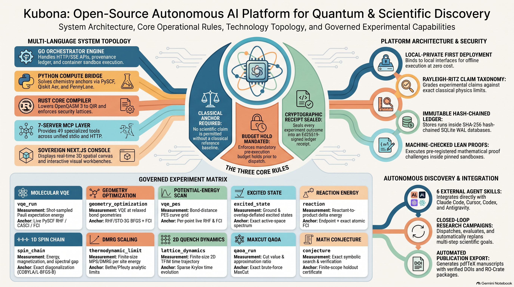
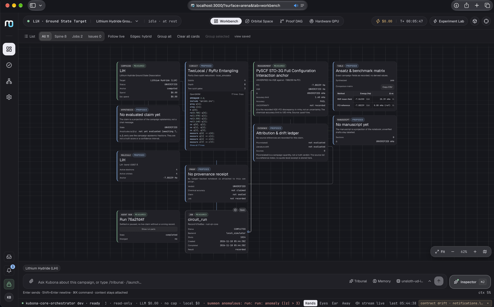

<div align="center">


# Kubona

### *See, observe, discover — then know.*

**An open-source quantum-computing and AI-enhanced scientific discovery platform for autonomous agents and human operators.**

<p align="center">
  <a href="LICENSE"></a>
  <a href="https://creativecommons.org/licenses/by/4.0/"></a>
  <a href="platform/kubona/"></a>
  <a href="platform/core/"></a>
  <a href="platform/crates/"></a>
  <a href="platform/console/"></a>
  <a href="wiki/"></a>
  <a href="https://www.linkedin.com/in/mainza-kangombe-6214295"></a>
</p>

</div>

---

**Kubona** (from Chitonga *ku-bona*, *"to see, observe, perceive"*) is an open-source, local-first quantum and scientific discovery platform built around a single rule: **no claim without a classical anchor, no execution without a budget hold, and no result without a cryptographic receipt.**

It pairs a sovereign Go orchestrator and hash-chained SQLite WAL provenance ledger with a Python quantum/chemistry compute bridge (`PySCF`, `Qiskit Aer`, `PennyLane`, `quimb`), a Rust QIR/IFC compiler core, a 7-server MCP tool layer (49 tools; unified `stdio` + standard Streamable HTTP `/mcp` with profiles, Resources, and Prompts), external AI agent skills (`skills/kubona*`), and a Next.js 3D operator console.

> [!NOTE]
> **Active Development:** A platform like this is never finished on day one; it compounds. **Kubona is in active development and becoming more capable every week** — tightening the feedback loop between what an agent proposes, what physics permits, and what the ledger can prove. Follow phased milestones in [`wiki/roadmap.md`](wiki/roadmap.md) and [`wiki/log.md`](wiki/log.md).

> [!IMPORTANT]
> **Deployment Target — Local-Private Production:** Kubona is engineered for single-host local-private operation (`127.0.0.1` bindings for API `:8080` and Console `:3000`, Unix Domain Socket bridge transport, Ed25519 mandate/session signing, and fail-closed budget/fidelity gates). All simulators, classical anchors, and local LLMs run offline at `$0.00`; cloud QPU dispatch and cloud LLMs (BYOK) are explicit opt-ins. See [`docs/local-deployment.md`](docs/local-deployment.md).

> **Status:** generated counts live in [`docs/repo-counts.md`](docs/repo-counts.md); run the gates below on the exact commit. Hosted CI is the authority for a pushed commit — do not cite a green state from a local run.

---

## Architecture Overview

<div align="center">
  <a href="assets/misc/Kubona_Platform_Overview_Infographic.png">
    
  </a>
</div>

- **Executive Presentation Deck (PDF):** [`assets/misc/Kubona_Quantum_AI_Discovery_Platform.pdf`](assets/misc/Kubona_Quantum_AI_Discovery_Platform.pdf)
- **Living Blueprint & Audit Trail:** [`wiki/overview.md`](wiki/overview.md) · [`wiki/roadmap.md`](wiki/roadmap.md) · [`docs/repo-counts.md`](docs/repo-counts.md)
- **Measured engineering reports:** [`docs/production-audit-2026-11-20.md`](docs/production-audit-2026-11-20.md) · [`docs/performance-research-2026-11-18.md`](docs/performance-research-2026-11-18.md) · [`docs/memory-management-research-2026-11-18.md`](docs/memory-management-research-2026-11-18.md)

---

## Sovereign Observatory Console — Dark Graphite Workbench

<div align="center">
  <a href="assets/screenshots/kubona_ui_screen_2.png">
    
  </a>
  <p><em>Dark Graphite theme: Focused Energy trajectory chart comparing VQE iterations against the FCI anchor, node toolbar controls, and live local Copilot response.</em></p>
</div>

---

## Current Capabilities by Category

### 1. Quantum Chemistry, Lattice Physics & Many-Body Simulation

- **Ab Initio & Variational Chemistry:** Run shot-sampled `VQE` (1–4 UCCSD `layers` with `ansatz_depth` and `two_qubit_gate_count`) alongside live `PySCF` reference baselines (`RHF`, `CASCI`, `FCI`) across `H₂`, `LiH`, `BeH₂`, `H₂O`, closed-shell charged ions (`charge ∈ [-2, 2]`, e.g., `H₃⁺`, `OH⁻` with typed parity validation), and 9–14 spatial-orbital active spaces (`N₂`, `CO` `CAS(4,4)` via `anchor_mode: "casci_active_space"`).
- **Potential Energy Surfaces & Geometry Optimization:** Execute bond-distance `PES` scans (simulator and governed per-point `hardware_pes`), `BFGS` equilibrium geometry optimization, multi-seed statistical `VQE` repeats, overlap-deflated excited states, reactant-to-product reaction energies ($\Delta E$), and RDKit ADMET/PAINS candidate triage.
- **Condensed-Matter & Tensor Networks:** Simulate 1D Heisenberg, anisotropic `XXZ` ($\Delta$), and `TFIM` spin chains (`COBYLA` + multi-start `L-BFGS-B`), compute `quimb` `MPS`/`DMRG` finite-size scaling to the thermodynamic limit ($1/N \to 0$, e.g., Bethe-ansatz `XXZ`), and evolve exact 2D `TFIM` quench dynamics (up to 100 time steps with `loschmidt_echo` and `zz_correlator_mean`) via sparse Krylov `expm_multiply`.
- **Combinatorial, Subspace & Error-Mitigated Workflows:** Run MaxCut `QAOA` (simulator and hardware loops), Quantum Krylov subspace diagonalization, Zero-Noise Extrapolation (`ZNE`) with measurement readout mitigation, and exact finite-scope mathematical conjecture verification.

### 2. Autonomous Discovery, Research Pipeline & Epistemic Governance

- **Closed-Loop Research Campaigns:** Plan, dispatch, evaluate, and automatically replan multi-step scientific campaigns from natural-language research goals (`then` / `->` / `;` pipelines via `/api/discovery/{plan,run}`).
- **Hypotheses, Pre-Registered Plans & Knowledge Registry:** Generate evidence-grounded hypotheses, run Elo tournaments, shortlist candidates, author `$0`-capable pre-registered experimental plans, track causal lineage in a byte-budgeted Research Graph, and gate repeated negative results via the tenant-scoped Lab Knowledge registry.
- **Session Autonomy & Operator Oversight:** Per-session agentic mode (`agentic_enabled`) with stage autonomy policies (`suggest` / `approve` / `notify` / `act`), operator halt/unlock, policy history & rollback, action receipts with undo, per-tenant agentic defaults, and `/api/ops/science` telemetry.
- **Machine-Enforced Claim Taxonomy:** Every experimental outcome is graded against its classical reference anchor (`verified`, `supported`, `plausible`, `speculative`, or `refuted`) under the Rayleigh-Ritz variational principle — never claiming quantum advantage from sub-FCI shot noise or by assertion.
- **Persistent Scientific Memory:** Tenant-scoped associative memory with semantic + lexical recall, automatic pre-turn recall, decay/consolidation, temporal supersession, dedupe, live operator retraction (`POST /api/memory/retract`), and an operator-exportable temporal graph.
- **Runtime Skills & Recorded Decision Evals:** Operator and seed `SKILL.md` instructions are advertised to the copilot by name/description only and read on demand through a read-only tool, with closed loader faults shown in Settings. Sha-pinned copilot decision fixtures produce Brier/ECE reports, surfaced in the model picker; an opt-in gate can require an evaluated model before a copilot change.

### 3. Cryptographic Provenance, Publication & Spend Settlement

- **Signed, Hash-Chained Receipts:** Every run, peer review, and lifecycle action seals into an Ed25519-signed, SHA-256 hash-chained SQLite WAL ledger with SHA-256-prefixed claim/review IDs and fail-closed `AdminAction` replay protection.
- **Server-Owned Branded Publications & RO-Crate Export:** Compose multi-format publications (`academic_preprint`, `white_paper`, `discovery_dossier`, `technical_report`) with the Milimo/Kubona logo, 9–12 evidence-hydrated sections, deterministic 300-DPI auto-generated PNG figures (`auto_figures: true`), real-table companion `paper.md` + `paper.html`, automated numeric & DOI-first Crossref citation verification (`POST /verify` with `verified: true` persistence), reproducible pdfTeX builds (`-no-shell-escape`), formal or empirical Zenodo deposit staging (`{"track": "empirical"}` after operator signoff), and complete **RO-Crate 1.1 + W3C PROV-JSON + CRediT** bundles (`GET /api/sessions/{id}/manuscripts/{mid}/export`).
- **Pre-Dispatch Fidelity & Calibration Gate:** Evaluates hardware `T₁`/`T₂`, two-qubit gate error, ZNE scale-folded circuit depth, closed-set known hardware backends, and calibration freshness (<24h) before admission, stamping deterministic `calibration_snapshot_id` (`cal_<sha256[:12]>`) and measured QPU `usage_seconds` onto every settled hardware workload.
- **Governed Spend Ledger:** Enforces operator-signed WebCrypto Ed25519 mandates, pre-execution budget holds, and measured QPU runtime settlement for IBM Quantum, with credential-gated Quantinuum dispatch and local/simulator runtimes. IonQ, AWS Braket, Rigetti, and neutral-atom providers are catalogued capability rows that **fail closed** until a reviewed adapter lands.
- **Machine-Checked Proofs:** 405 pre-registered Lean 4 challenges run inside a pinned, offline sandbox (Lean 4.34.1, comparator v4.34.0, `lean4export`, landrun). Only a kernel-accepted solution is attested as `live_kernel_proven`; signed attestations are verified against the configured comparator key. See [`docs/lean-comparator-runbook-2026-11-18.md`](docs/lean-comparator-runbook-2026-11-18.md).

### 4. Polyglot Core, MCP-Native Architecture & External Agent Skills

- **7-Server MCP Surface (49 Tools; Unified `stdio` + Standard Streamable HTTP `/mcp`):** Dedicated Model Context Protocol servers (`execution`, `compiler`, `cost`, `provenance`, `control`, `science`, `world`) exposed over standard MCP Streamable HTTP (`http://127.0.0.1:8123/mcp?profile=science|read-only|governance|ops|world|all`), unified `stdio` (`python -m kubona.run serve-mcp`), and legacy `/rpc` (including X25519+ML-KEM hybrid envelopes). Ships with server `instructions`, read-only MCP Resources (`kubona://skills`, `kubona://contracts/error-catalog`, `kubona://contracts/mcp-catalog`, `kubona://contracts/rate-cards`), and 5 guided MCP Prompts.
- **External AI Agent Skills & Runtime Discovery:** A modular 6-skill suite under [`skills/`](skills/) (`kubona` router, `kubona-connect`, `kubona-experiments`, `kubona-governance`, `kubona-research`, `kubona-ops`) verified in CI by `scripts/skill-lint.py --strict`, installable into Claude Code / Cursor / Codex / Antigravity via `scripts/install-skills.sh <host>`, and paired with `python -m kubona.run mcp-config` plus live `kubonad` discovery endpoints (`GET /api/openapi.json`, `GET /.well-known/agent.json`, `GET /llms.txt`).
- **Go + Rust + Python Execution Stack:** Go orchestrator (`kubonad`), hardened Rust native `qir-core` (OpenQASM 2/3 to QIR LLVM IR lowering with bounded input/register limits and `pi`/`sdg`/`tdg` support) and `ifc-core` (information-flow confidentiality lattice), and rootless Docker/`runsc` execution sandboxes.

### 5. The Sovereign Observatory Console

- **Real-Time 3D Workbench & Full Oversight Surfaces:** Interactive Three.js molecular, orbital, proof-DAG, and hardware QPU visualizations paired with live Server-Sent Events (`SSE`) replay (`Last-Event-ID`), **Results Studio** (charts, **Research Pipeline**, and **Publication** workflow with numeric/citation verification and RO-Crate/PROV export), **Autonomy Cockpit** (stage policy, operator halt/rollback, action receipts/undo, science telemetry), **Experiment & Discovery Lab** (`Cmd+E` / `Ctrl+E`), keyless first-run lab bootstrap, restart-orphan loop settlement, dismissible floating shell popovers (click-away / `Escape` / close button), and an **Attention Director** presence dial (`Hands` / `Eyes` / `Ear` / `Away`) with ambient laboratory sound **muted by default**.

### 6. Performance & Memory Engineering

- **Measured transport and storage:** JSON responses carry `Content-Length` and negotiate gzip (pooled compressor); SSE fans one per-session ledger poll out to every client; schema 16 adds the session/chat/job ordering indexes; the SQLite pool is bounded and WAL is set once per database.
- **Measured compute policy:** every Aer simulator gets a cgroup-derived `max_memory_mb` and a budget-derived qubit ceiling (27q on the 4 GiB bridge); wide shallow circuits use MPS; chemistry anchors are LRU-cached; transpile level is configurable; the bridge caps glibc arenas/BLAS threads and trims after jobs.
- **Bounded agentic memory:** global item/byte budget with fair-share eviction, decay + consolidation, automatic pre-turn recall, deterministic extractive compaction, dedupe, temporal validity/supersession, int8 vectors (4× smaller), embedding cache, and a tenant-scoped temporal graph export.
- **Observable by default:** `/metrics` exposes Go heap/GC/RSS, cgroup limits, bridge RSS (freshness-checked), and memory-store counts; bearer-only `/debug/pprof` is opt-in via `KUBONA_PPROF=1`; `scripts/perf-gate.sh` and a CI `performance-gate` job guard the named benchmarks.

---

## Governed Experiment Matrix

All 19 `experiment-result-v1` kinds execute through the governed Go job rail; the matrix below shows the principal capability families (13 rows, not one row per kind). Each result validates against [`platform/contracts/experiment-result-v1.schema.json`](platform/contracts/experiment-result-v1.schema.json), folds into campaign state, and renders in the Console's **Experiment & Discovery Lab** and **Results Studio**:

| Capability | Kind | Measurement | Classical Anchor |
| --- | --- | --- | --- |
| **Molecular VQE** | `vqe` (`vqe_run`) | Shot-sampled Pauli expectation energy | Live PySCF RHF / CASCI / FCI |
| **Geometry Optimization** | `geometry_optimization` | VQE at classically relaxed bond geometry | Curated scan or caller-geometry RHF/STO-3G BFGS + FCI |
| **Repeated VQE** | `vqe_repeats` | Multi-seed mean energy, shot σ, and between-run SE | Full FCI at identical geometry |
| **Potential-Energy Scan** | `pes` (`vqe_pes`) | Bond-distance energy curve across geometry grid | Per-point live RHF & FCI |
| **Hardware PES** | `hardware_pes` | Single QPU batch across source PES geometries | Per-point FCI anchors (optional ZNE) |
| **Excited State** | `excited_state` | Ground + overlap-deflated first excited state (`H2`, `LiH`, `BeH2`, `H2O`) | Exact active-space spectrum |
| **Reaction Energy** | `reaction` | Reactant-to-product ΔE (`H2`, `LiH`, `BeH2`, `H2O`) | Active-space endpoint + exact atomic FCI |
| **1D Spin Chain** | `spin_chain` | Variational energy, magnetization, and gap (`heisenberg`, `xxz`, `tfim`) | Exact diagonalization (`COBYLA` + multi-start `L-BFGS-B`) |
| **DMRG Scaling** | `thermodynamic_limit` | Finite-size MPS/DMRG energy per site & $1/N$ extrapolation | Bethe/Pfeuty analytic limit (`heisenberg`/`tfim`) |
| **2D Quench Dynamics** | `lattice_dynamics` | Exact finite-size 2D TFIM $\langle Z \rangle(t)$ trajectory | Sparse Krylov `expm_multiply` time evolution |
| **MaxCut QAOA** | `qaoa` (`qaoa_run`) | Shot-sampled cut value and approximation ratio | Exact brute-force MaxCut |
| **Math Conjecture** | `conjecture` | Exact symbolic/rational search + holdout verification | Finite-scope holdout certificate + known-law registry |
| **Discovery Protocol** | `/api/discovery/{plan,run}` | 1–5 sequential governed jobs (`then` / `->` / `;` pipelines) | Deterministic planner + ledger-linked job summaries |

---

## System Topology

| Path | Layer | Role |
| --- | --- | --- |
| [`platform/core/`](platform/core/) | **Go Orchestrator (`:8080`)** | HTTP/SSE API, hash-chained provenance ledger, job admission & fidelity gates, campaign replanning, flight recorder, and Docker/`runsc` sandbox runner. |
| [`platform/bridge/`](platform/bridge/) | **Quantum Bridge (`UDS / gRPC`)** | PySCF, Qiskit Aer, PennyLane, and `quimb` compute service over `unix:///run/kubona/bridge.sock` for chemistry anchors, lattice solvers, and QPU dispatch. |
| [`platform/crates/`](platform/crates/) | **Rust Core** | `qir-core` (OpenQASM 3.0 to LLVM IR lowering) and `ifc-core` (information-flow confidentiality lattice). |
| [`platform/kubona/`](platform/kubona/) | **Python Runtime & MCP** | 7 MCP servers (49 tools; unified `stdio` + Streamable HTTP `/mcp` with profiles, Resources & Prompts: `execution`, `compiler`, `cost`, `provenance`, `control`, `science`, `world`), mixed-state autodiff, ansatz transfer priors, and register packing. |
| [`platform/console/`](platform/console/) | **Sovereign Console (`:3000`)** | Next.js operator workbench with Spatial Canvas (3D Observatory), Results Studio, Experiment & Discovery Lab (`Cmd+E`), Epistemic Tribunal, Flight Recorder, and WebCrypto Ed25519 signing. |
| [`platform/contracts/`](platform/contracts/) | **Shared Contracts** | JSON schemas (`experiment-result-v1`, OpenAPI, console contract inventory), error catalog, rate cards, and device calibration profiles. |
| [`wiki/`](wiki/) | **Blueprint Wiki** | 168 cross-linked design, entity, and audit pages validated in CI by `scripts/wiki-lint.py --strict`. |

---

## Quickstart: Local-Private Docker Stack (Recommended)

**Prerequisites:** Docker Compose v2, Go 1.27+, Node 22 + pnpm 11, Python 3.11 + `uv` (native development); the Docker path carries its own toolchain.

The production stack binds strictly to `127.0.0.1:8080` (API), `127.0.0.1:3000` (Console), and `127.0.0.1:8123` (MCP Streamable HTTP gateway), communicating with the Python bridge over an internal Unix Domain Socket volume.

```bash
# 1. Configure environment & keys
cp .env.example .env
chmod 600 .env
# Populate KUBONA_API_TOKEN and KUBONA_SECRET_KEY in .env (e.g. openssl rand -hex 32)
# Optional: generate a reviewer mandate key via (cd platform/core && go run ./cmd/kubonad keygen)

# 2. Build and start preflight, bridge, kubonad, console, backup loop, and MCP HTTP gateway
docker compose --env-file .env -f platform/docker/compose.prod.yml up --build -d

# 3. Verify health, readiness, and loopback-only exposure
curl -fsS http://127.0.0.1:8080/api/health
curl -fsS http://127.0.0.1:8080/api/ready
scripts/local-deployment-check.sh

# 4. Create the locked Python environment and run the deployment doctor
cd platform
uv sync --locked --extra dev --extra qiskit --extra chemistry
.venv/bin/python -m kubona.run doctor --env-file ../.env
```

Open **`http://localhost:3000`** in your browser. Press **`Cmd+E`** (`Ctrl+E`) or click **Experiment Lab** in the top bar to launch single experiments, multi-step discovery protocols, or governed QPU runs.

### Connect External AI Agents (MCP, Skills & Discovery)

```bash
# Generate copy-pasteable MCP client config (Claude Code, Cursor, Codex, Antigravity)
platform/.venv/bin/python -m kubona.run mcp-config --client claude-code --transport http --profile science

# Install Kubona's 6 external agent skills into your host
scripts/install-skills.sh claude   # or: cursor | codex | antigravity | project

# Runtime HTTP/A2A discovery endpoints on kubonad (:8080)
curl -fsS http://127.0.0.1:8080/llms.txt
curl -fsS http://127.0.0.1:8080/.well-known/agent.json
curl -fsS http://127.0.0.1:8080/api/openapi.json | head -c 200
```

---

## Quickstart: Native Development ($0.00 / Zero-QPU)

Python dependencies are locked in [`platform/uv.lock`](platform/uv.lock); use
`uv sync --locked` rather than `pip install -e`. After editing
`platform/pyproject.toml`, run `uv lock` and commit both files.

```bash
# 0. Create the locked Python environment (uv 0.11.28+)
cd platform
uv sync --locked --extra dev --extra qiskit --extra chemistry
cd ..

# 1. Start the Python Quantum Bridge (Unix socket or localhost:50051)
cd platform/bridge
../.venv/bin/python server.py

# 2. Start the Go Orchestrator (:8080)
cd platform/core
go run ./cmd/kubonad --port 8080

# 3. Install and start the Next.js Sovereign Console (:3000)
cd platform/console
pnpm install --frozen-lockfile
pnpm dev --port 3000
```

### Example API Calls

```bash
# Run an XXZ spin-chain experiment with anisotropy Δ = 1.5
curl -fsS -X POST http://127.0.0.1:8080/api/experiments \
  -H "Authorization: Bearer $KUBONA_API_TOKEN" \
  -H "Content-Type: application/json" \
  -d '{"session_id":"<session-id>","spec":{"kind":"spin_chain","model":"xxz","n_sites":4,"coupling":1.0,"anisotropy":1.5,"field":0.4,"layers":3,"shots":8192},"budget_usd":1}'

# Plan and execute a multi-step discovery protocol
curl -fsS -X POST http://127.0.0.1:8080/api/discovery/plan \
  -H "Content-Type: application/json" \
  -d '{"goal":"optimize LiH geometry then run PES scan then check excited state"}'
```

---

## Verification & Quality Gates

```bash
# Go Orchestrator unit & integration suite
cd platform/core && go test ./...

# Rust native QIR compiler & IFC lattice
cargo test --manifest-path platform/crates/qir-core/Cargo.toml
cargo test --manifest-path platform/crates/ifc-core/Cargo.toml

# Python runtime, bridge, DMRG, and scientific solvers
(cd platform && uv sync --locked --extra dev --extra qiskit --extra chemistry && .venv/bin/python -m pytest bridge/ tests/)

# Console TypeScript, ESLint, Vitest, and OpenAPI/contract gates
cd platform/console && pnpm exec tsc --noEmit && pnpm lint && pnpm test
pnpm test:browser   # real-Chromium component tests (once: pnpm exec playwright install chromium)
python3 scripts/console-contract-inventory.py --check
node scripts/console-openapi.mjs --check
node scripts/console-scale-lint.mjs       # role-named radius/type only
node scripts/console-color-utility-lint.mjs
python3 scripts/repo-counts.py --check

# Performance/memory regression gate (Go benchmarks, memory lifecycle,
# simulator policy, console bundle budgets)
bash scripts/perf-gate.sh

# Strict wiki blueprint lint
python3 scripts/wiki-lint.py --strict
```

### Operations: memory, retention, and profiling

```bash
# Build the CLI once (from the repo root)
(cd platform/core && go build -o kubonad ./cmd/kubonad)
CLI=./platform/core/kubonad

# One-time incremental auto-vacuum migration (takes a verified snapshot first)
$CLI vacuum --db "$HOME/.kubona/kubona.db"

# Backup, SHA-256 verification, and scratch restore drill
$CLI backup --db "$HOME/.kubona/kubona.db" --out /tmp/kubona.db.backup
KUBONAD_BIN="$CLI" scripts/backup-restore-check.sh /tmp/kubona.db.backup

# Memory pressure / pgvector readiness, temporal graph, outcome feedback
$CLI memory-status --db "$HOME/.kubona/kubona.db" --json
$CLI memory-graph --db "$HOME/.kubona/kubona.db" --tenant default
$CLI memory-feedback --db "$HOME/.kubona/kubona.db" --id <memory-id> --useful

# Bearer-only profiler (never enabled in the default stack)
KUBONA_PPROF=1 $CLI --db "$HOME/.kubona/kubona.db" --port 8080
```

---

## Author & License

- **Author:** Mainza Kangombe — Founder & Lead Architect, Milimo Quantum ([LinkedIn](https://www.linkedin.com/in/mainza-kangombe-6214295) · [@mainza-ai](https://github.com/mainza-ai))
- **Software License:** [Apache License 2.0](LICENSE) (see [`NOTICE`](NOTICE) and [`CONTRIBUTING.md`](CONTRIBUTING.md))
- **Documentation & Wiki License:** [Creative Commons Attribution 4.0 International (CC-BY-4.0)](https://creativecommons.org/licenses/by/4.0/)
