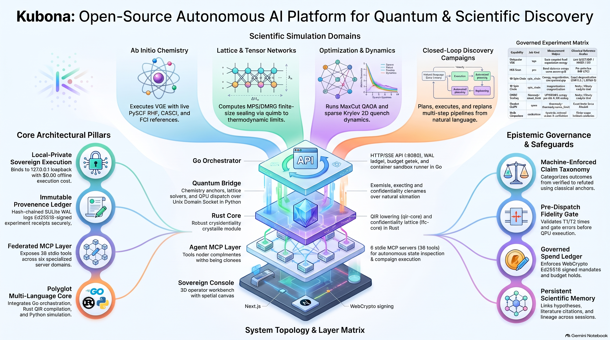
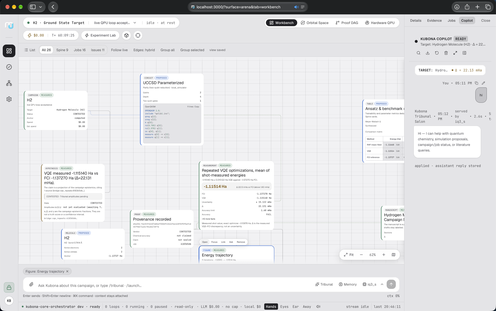
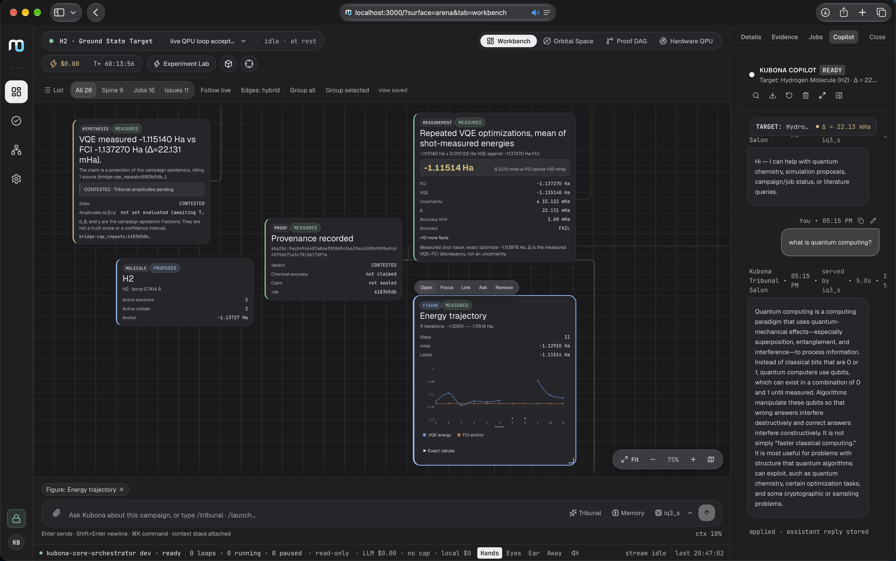

<div align="center">


# Kubona

### *See, observe, discover — then know.*

**An open-source quantum-computing and AI-enhanced scientific discovery platform for autonomous agents and human operators.**

<p align="center">
  <a href="LICENSE"></a>
  <a href="https://creativecommons.org/licenses/by/4.0/"></a>
  <a href="platform/kubona/"></a>
  <a href="platform/core/"></a>
  <a href="platform/crates/"></a>
  <a href="platform/console/"></a>
  <a href="wiki/"></a>
  <a href="https://www.linkedin.com/in/mainza-kangombe-6214295"></a>
</p>

</div>

---

**Kubona** (from Chitonga *ku-bona*, *"to see, observe, perceive"*) is an open-source, local-first quantum and scientific discovery platform built around a single rule: **no claim without a classical anchor, no execution without a budget hold, and no result without a cryptographic receipt.**

It pairs a sovereign Go orchestrator and hash-chained SQLite WAL provenance ledger with a Python quantum/chemistry compute bridge (`PySCF`, `Qiskit Aer`, `PennyLane`, `quimb`), a Rust QIR/IFC compiler core, a 6-server MCP tool layer (38 tools over `stdio`), and a Next.js 3D operator console.

> [!NOTE]
> **Active Development:** A platform like this is never finished on day one; it compounds. **Kubona is in active development and becoming more capable every week** — tightening the feedback loop between what an agent proposes, what physics permits, and what the ledger can prove. Follow phased milestones in [`wiki/roadmap.md`](wiki/roadmap.md) and [`wiki/log.md`](wiki/log.md).

> [!IMPORTANT]
> **Deployment Target — Local-Private Production:** Kubona is engineered for single-host local-private operation (`127.0.0.1` bindings for API `:8080` and Console `:3000`, Unix Domain Socket bridge transport, Ed25519 mandate/session signing, and fail-closed budget/fidelity gates). All simulators, classical anchors, and local LLMs run offline at `$0.00`; cloud QPU dispatch and cloud LLMs (BYOK) are explicit opt-ins. See [`docs/local-deployment.md`](docs/local-deployment.md).

---

## Architecture Overview

<div align="center">
  <a href="assets/misc/Kubona_Platform_Overview_Infographic.png">
    
  </a>
</div>

- **Kubona & The Autonomous Quantum Scientific Method (Video):** [Kubona & The Autonomous Quantum Scientific Method](https://youtu.be/y6EM4CKZFQA)
- **User Interface Preview (Video):** [Kubona - User Interface preview](https://www.youtube.com/watch?v=okA0geYELYk)
- **Executive Presentation Deck (PDF):** [`assets/misc/Kubona_Quantum_AI_Discovery_Platform.pdf`](assets/misc/Kubona_Quantum_AI_Discovery_Platform.pdf)
- **Living Blueprint & Audit Trail:** [`wiki/overview.md`](wiki/overview.md) · [`wiki/roadmap.md`](wiki/roadmap.md) · [`docs/repo-counts.md`](docs/repo-counts.md)

---

## Sovereign Observatory Console (UI Preview & Screenshots)

<div align="center">
  <a href="https://www.youtube.com/watch?v=okA0geYELYk">
    
  </a>
  <p><em>Video walkthrough: <a href="https://www.youtube.com/watch?v=okA0geYELYk">Kubona - User Interface preview</a> (YouTube)</em></p>
</div>

<div align="center">
  <a href="assets/screenshots/kubona_ui_screen_1.png">
    
  </a>
  <p><em>Light Paper theme: Spatial Workbench linking H₂ campaign, OpenQASM 2.0 UCCSD circuit, repeated VQE vs FCI measurement, SHA-256 provenance proof, and Kubona Copilot drawer.</em></p>
</div>

<div align="center">
  <a href="assets/screenshots/kubona_ui_screen_2.png">
    
  </a>
  <p><em>Dark Graphite theme: Focused Energy trajectory chart comparing VQE iterations against the FCI anchor, node toolbar controls, and live local Copilot response.</em></p>
</div>

---

## Current Capabilities by Category

### 1. Quantum Chemistry, Lattice Physics & Many-Body Simulation

- **Ab Initio & Variational Chemistry:** Run shot-sampled `VQE` alongside live `PySCF` reference baselines (`RHF`, `CASCI`, `FCI`) across `H₂`, `LiH`, `BeH₂`, `H₂O`, and custom closed-shell `STO-3G` molecular geometries.
- **Potential Energy Surfaces & Geometry Optimization:** Execute bond-distance `PES` scans, `BFGS` equilibrium geometry optimization, multi-seed statistical `VQE` repeats, overlap-deflated excited states, and reactant-to-product reaction energies ($\Delta E$).
- **Condensed-Matter & Tensor Networks:** Simulate 1D Heisenberg, anisotropic `XXZ` ($\Delta$), and `TFIM` spin chains (`COBYLA` + multi-start `L-BFGS-B`), compute `quimb` `MPS`/`DMRG` finite-size scaling to the thermodynamic limit ($1/N \to 0$), and evolve exact 2D `TFIM` quench dynamics via sparse Krylov `expm_multiply`.
- **Combinatorial, Subspace & Error-Mitigated Workflows:** Run MaxCut `QAOA` (simulator and hardware loops), Quantum Krylov subspace diagonalization, Zero-Noise Extrapolation (`ZNE`) with measurement readout mitigation, and exact finite-scope mathematical conjecture verification.

### 2. Autonomous Discovery & Epistemic Governance

- **Closed-Loop Research Campaigns:** Plan, dispatch, evaluate, and automatically replan multi-step scientific campaigns from natural-language research goals (`then` / `->` / `;` pipelines via `/api/discovery/{plan,run}`).
- **Machine-Enforced Claim Taxonomy:** Every experimental outcome is graded against its classical reference anchor (`verified`, `supported`, `plausible`, `speculative`, or `refuted`) — never claiming quantum advantage by assertion.
- **Persistent Scientific Memory:** Hybrid full-text and structured memory graph linking hypotheses, OpenAlex/literature citations, artifacts, and experimental lineage across sessions.

### 3. Cryptographic Provenance & Spend Settlement

- **Signed, Hash-Chained Receipts:** Every run emits a schema-validated `experiment-result-v1` payload sealed into an Ed25519-signed, SHA-256 hash-chained SQLite WAL ledger.
- **Pre-Dispatch Fidelity Gate:** Evaluates hardware `T₁`/`T₂`, two-qubit gate error, and calibration freshness (<24h) before a circuit is admitted to a QPU.
- **Governed Spend Ledger:** Enforces operator-signed WebCrypto Ed25519 mandates, pre-execution budget holds, and measured QPU runtime settlement across IBM Quantum, IonQ, AWS Braket, and local private runtimes.

### 4. Polyglot Core & MCP-Native Architecture

- **6-Server MCP Surface (38 Tools over `stdio`):** Dedicated Model Context Protocol servers (`execution`, `compiler`, `cost`, `provenance`, `control`, `world`) so autonomous AI agents can inspect state, launch campaigns, and audit receipts.
- **Go + Rust + Python Execution Stack:** Go orchestrator (`kubonad`), Rust native `qir-core` (OpenQASM 3.0 to LLVM IR lowering) and `ifc-core` (information-flow confidentiality lattice), and rootless Docker/`runsc` execution sandboxes.

### 5. The Sovereign Observatory Console

- **Real-Time 3D Workbench:** Interactive Three.js molecular, orbital, proof-DAG, and hardware QPU visualizations paired with live Server-Sent Events (`SSE`) replay (`Last-Event-ID`), interactive **Results Studio** charts, and the unified **Experiment & Discovery Lab** (`Cmd+E` / `Ctrl+E`).

---

## Governed Experiment Matrix

All 13 experiment kinds execute through the governed Go job rail, validate against [`platform/contracts/experiment-result-v1.schema.json`](platform/contracts/experiment-result-v1.schema.json), fold into campaign state, and render in the Console's **Experiment & Discovery Lab** and **Results Studio**:

| Capability | Kind | Measurement | Classical Anchor |
| --- | --- | --- | --- |
| **Molecular VQE** | `vqe` (`vqe_run`) | Shot-sampled Pauli expectation energy | Live PySCF RHF / CASCI / FCI |
| **Geometry Optimization** | `geometry_optimization` | VQE at classically relaxed bond geometry | Curated scan or caller-geometry RHF/STO-3G BFGS + FCI |
| **Repeated VQE** | `vqe_repeats` | Multi-seed mean energy, shot σ, and between-run SE | Full FCI at identical geometry |
| **Potential-Energy Scan** | `pes` (`vqe_pes`) | Bond-distance energy curve across geometry grid | Per-point live RHF & FCI |
| **Hardware PES** | `hardware_pes` | Single QPU batch across source PES geometries | Per-point FCI anchors (optional ZNE) |
| **Excited State** | `excited_state` | Ground + overlap-deflated first excited state (`H2`, `LiH`, `BeH2`, `H2O`) | Exact active-space spectrum |
| **Reaction Energy** | `reaction` | Reactant-to-product ΔE (`H2`, `LiH`, `BeH2`, `H2O`) | Active-space endpoint + exact atomic FCI |
| **1D Spin Chain** | `spin_chain` | Variational energy, magnetization, and gap (`heisenberg`, `xxz`, `tfim`) | Exact diagonalization (`COBYLA` + multi-start `L-BFGS-B`) |
| **DMRG Scaling** | `thermodynamic_limit` | Finite-size MPS/DMRG energy per site & $1/N$ extrapolation | Bethe/Pfeuty analytic limit (`heisenberg`/`tfim`) |
| **2D Quench Dynamics** | `lattice_dynamics` | Exact finite-size 2D TFIM $\langle Z \rangle(t)$ trajectory | Sparse Krylov `expm_multiply` time evolution |
| **MaxCut QAOA** | `qaoa` (`qaoa_run`) | Shot-sampled cut value and approximation ratio | Exact brute-force MaxCut |
| **Math Conjecture** | `conjecture` | Exact symbolic/rational search + holdout verification | Finite-scope holdout certificate + known-law registry |
| **Discovery Protocol** | `/api/discovery/{plan,run}` | 1–5 sequential governed jobs (`then` / `->` / `;` pipelines) | Deterministic planner + ledger-linked job summaries |

---

## System Topology

| Path | Layer | Role |
| --- | --- | --- |
| [`platform/core/`](platform/core/) | **Go Orchestrator (`:8080`)** | HTTP/SSE API, hash-chained provenance ledger, job admission & fidelity gates, campaign replanning, flight recorder, and Docker/`runsc` sandbox runner. |
| [`platform/bridge/`](platform/bridge/) | **Quantum Bridge (`UDS / gRPC`)** | PySCF, Qiskit Aer, PennyLane, and `quimb` compute service over `unix:///run/kubona/bridge.sock` for chemistry anchors, lattice solvers, and QPU dispatch. |
| [`platform/crates/`](platform/crates/) | **Rust Core** | `qir-core` (OpenQASM 3.0 to LLVM IR lowering) and `ifc-core` (information-flow confidentiality lattice). |
| [`platform/kubona/`](platform/kubona/) | **Python Runtime & MCP** | 6 stdio MCP servers (38 tools: `execution`, `compiler`, `cost`, `provenance`, `control`, `world`), mixed-state autodiff, ansatz transfer priors, and register packing. |
| [`platform/console/`](platform/console/) | **Sovereign Console (`:3000`)** | Next.js operator workbench with Spatial Canvas (3D Observatory), Results Studio, Experiment & Discovery Lab (`Cmd+E`), Epistemic Tribunal, Flight Recorder, and WebCrypto Ed25519 signing. |
| [`platform/contracts/`](platform/contracts/) | **Shared Contracts** | JSON schemas (`experiment-result-v1`, OpenAPI, console contract inventory), error catalog, rate cards, and device calibration profiles. |
| [`wiki/`](wiki/) | **Blueprint Wiki** | 156 cross-linked design, entity, and audit pages validated in CI by `scripts/wiki-lint.py --strict`. |

---

## Quickstart: Local-Private Docker Stack (Recommended)

The production stack binds strictly to `127.0.0.1:8080` (API) and `127.0.0.1:3000` (Console), communicating with the Python bridge over an internal Unix Domain Socket volume.

```bash
# 1. Configure environment & keys
cp .env.example .env
chmod 600 .env
# Populate KUBONA_API_TOKEN and KUBONA_SECRET_KEY in .env (e.g. openssl rand -hex 32)
# Optional: generate a reviewer mandate key via (cd platform/core && go run ./cmd/kubonad keygen)

# 2. Build and start bridge, preflight gate, kubonad, and console
docker compose --env-file .env -f platform/docker/compose.prod.yml up --build -d

# 3. Verify health, readiness, and loopback-only exposure
curl -fsS http://127.0.0.1:8080/api/health
curl -fsS http://127.0.0.1:8080/api/ready
scripts/local-deployment-check.sh

# 4. Run the deployment doctor
cd platform && .venv/bin/python -m kubona.run doctor --env-file ../.env
```

Open **`http://localhost:3000`** in your browser. Press **`Cmd+E`** (`Ctrl+E`) or click **Experiment Lab** in the top bar to launch single experiments, multi-step discovery protocols, or governed QPU runs.

---

## Quickstart: Native Development ($0.00 / Zero-QPU)

```bash
# 1. Start the Python Quantum Bridge (Unix socket or localhost:50051)
cd platform/bridge
../.venv/bin/python server.py

# 2. Start the Go Orchestrator (:8080)
cd platform/core
go run ./cmd/kubonad --port 8080

# 3. Start the Next.js Sovereign Console (:3000)
cd platform/console
pnpm dev --port 3000
```

### Example API Calls

```bash
# Run an XXZ spin-chain experiment with anisotropy Δ = 1.5
curl -fsS -X POST http://127.0.0.1:8080/api/experiments \
  -H "Authorization: Bearer $KUBONA_API_TOKEN" \
  -H "Content-Type: application/json" \
  -d '{"session_id":"<session-id>","spec":{"kind":"spin_chain","model":"xxz","n_sites":4,"coupling":1.0,"anisotropy":1.5,"field":0.4,"layers":3,"shots":8192},"budget_usd":1}'

# Plan and execute a multi-step discovery protocol
curl -fsS -X POST http://127.0.0.1:8080/api/discovery/plan \
  -H "Content-Type: application/json" \
  -d '{"goal":"optimize LiH geometry then run PES scan then check excited state"}'
```

---

## Verification & Quality Gates

```bash
# Go Orchestrator unit & integration suite
cd platform/core && go test ./...

# Rust native QIR compiler & IFC lattice
cargo test --manifest-path platform/crates/qir-core/Cargo.toml
cargo test --manifest-path platform/crates/ifc-core/Cargo.toml

# Python runtime, bridge, DMRG, and scientific solvers
PYTHONPATH=platform/bridge:platform platform/.venv/bin/pytest platform/bridge/ platform/tests/

# Console TypeScript, ESLint, Vitest, and OpenAPI/contract gates
cd platform/console && pnpm exec tsc --noEmit && pnpm lint && pnpm test
python3 scripts/console-contract-inventory.py --check
node scripts/console-openapi.mjs --check

# Strict wiki blueprint lint
python3 scripts/wiki-lint.py --strict
```

---

## Author & License

- **Author:** Mainza Kangombe — Founder & Lead Architect, [Milimo Quantum](https://www.youtube.com/@MilimoQuantum) ([LinkedIn](https://www.linkedin.com/in/mainza-kangombe-6214295) · [@mainza-ai](https://github.com/mainza-ai))
- **Software License:** [Apache License 2.0](LICENSE) (see [`NOTICE`](NOTICE) and [`CONTRIBUTING.md`](CONTRIBUTING.md))
- **Documentation & Wiki License:** [Creative Commons Attribution 4.0 International (CC-BY-4.0)](https://creativecommons.org/licenses/by/4.0/)
