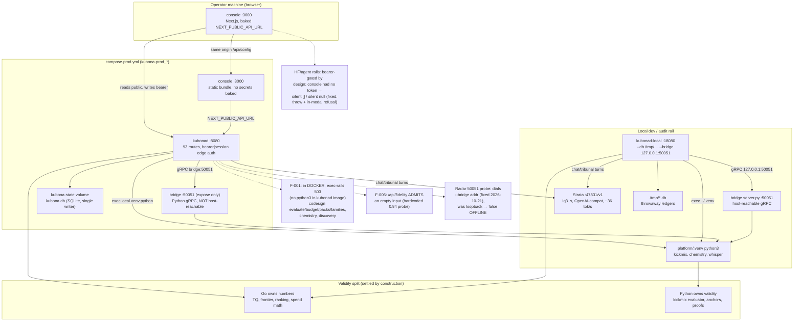

# Audit Topology & Live Verification Map

> **What this page is.** The deployment topology as *verified live* on
> 2026-10-21 — which process listens where, which rail executes which
> language, what the browser can and cannot reach, and where the audit
> proved failure. Companion to [[platform-architecture-diagram]] (the
> design-side map, snapshot 2026-10-12): this page records the *wiring as
> probed*, including the gaps. Refresh duty: re-verify after any
> compose/Dockerfile/port/auth change — a stale map is worse than none.
> Evidence class: live `curl` + Playwright/Chromium against the compose
> stack and an isolated local rail (`--db /tmp/…`, host bridge).

## What the arrows proved (2026-10-21)

- **Console → kubonad:** 78 distinct console call paths, zero hit a
  missing backend route (exhaustive cross-check). Bearerless writes 401,
  wrong token 401, plain token on admin rails 403 with envelope mismatch.
- **kubonad → bridge (compose):** krylov/mitigation/qir live through gRPC;
  bridge kill → labeled classical fallback + recovery (no hangs).
- **kubonad → venv (compose): ABSENT** — F-001. The same rails work on the
  local rail (venv present): TQ golden, evaluate valid/invalid (+
  `failure_details` recipes), frontier best-pick, batch, budget union
  bound, families lineage, packs, discovery pipeline.
- **kubonad → Strata:** chat stream, 4-turn tribunal (template fallback when
  LLM absent — contested, obligation open, coverage honest). Turn output
  capped at 1500 tokens (uncapped turns rambled past 90s and 300s ctx on
  the default stack; CompleteCapped + min(operator ceiling, cap)). Wired
  turns name the session id verbatim (before: every session-scoped tool
  call failed "unknown session" and contested the run). Consensus TRUE
  proven live (Strata iq3_s, all facets authored, all tools OK). Mesh
  route qualifies bare default-model IDs ("iq3_s" → "strata/iq3_s";
  before: misrouted as omlx-cloud and refused for spend).
- **Spend honesty:** Strata (default provider) filed spend records and
  refused usage-omitted calls as "blind cloud spend" — fixed to the
  `IsLocalProvider` single home (client x4 + server `recordLoopSpend` +
  copilot `engineNotice` hint + cost-test local list).
- **Browser truth:** first paint 0 console errors / 0 failed requests; all
  6 surfaces + 3 arena tabs render; full chat→tribunal→launch→COMPLETED
  job loop through the UI; kill-banner on backend loss; honest refusals
  for HF search, agent register, settings save, mesh route, chat without
  model. Found visually: radar false-OFFLINE, recorder "Iteration 15 of
  7", orb text upside-down mid-cycle (rotation keyframes), unnamed QIR
  copy button — all fixed and re-verified with screenshots.

## Node evidence

- Compose: `platform/docker/compose.prod.yml` (kubonad `--bridge
  bridge:50051`, `KUBONA_ALLOW_PLAINTEXT=1` in-network only).
- Routes: 93 `HandleFunc` in `platform/core/pkg/api/server.go` (recount
  with `grep -o 'HandleFunc("[^"]*"'` — `rg` is broken on this host).
- Radar: `handleRadar` dials `s.bridgeAddr` for 50051
  (`server.go`, `SetBridgeAddr` from `--bridge`).
- Python exec: `runBridgePython` + `findPythonVenv`
  (`server.go:3577+`); kubonad image has no python
  (`platform/docker/Dockerfile.kubonad`).
- LLM: `pkg/llm/client.go` (`CompleteCapped`, spend silence via
  `IsLocalProvider`), `pkg/llm/cost.go`, `pkg/agents/collective.go`
  (4-turn tribunal, `tribunalTurnMaxTokens = 1500`, coverage-gated seal).
- Console honesty: `lib/api.ts` (throw-on-refusal for HF + agent
  create), `CognitiveMesh.tsx` (in-modal `role=alert`), `globals.css`
  (orb pulse without rotation), `FlightRecorder.tsx` (milestone label),
  `FleetRadar.tsx` (bridgeAddr probe display).

## Refresh checklist (after any topology change)

1. `docker compose up --build -d` + smoke matrix (health/ready/config).
2. Re-run route sweep + console cross-check (scripts in `/tmp` notes).
3. Re-screenshot all 6 surfaces + arena tabs (Playwright).
4. `python3 scripts/wiki-lint.py --strict` must stay clean.

Related: [[platform-architecture-diagram]] · [[frontend-backend-ui-ux-audit]]
· [[implementation-gaps]] · [[evaluator-guided-circuit-codesign]] ·
[[local-simulation-test-scenarios]] · [[circuit-codesign-ux-plan]] ·
[[multimodal-mission-control-and-custom-agents]]
