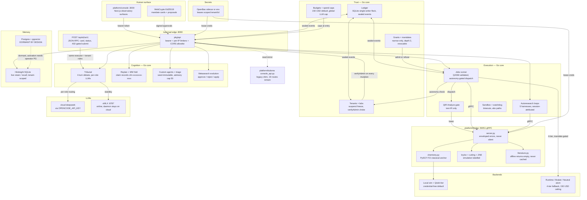

# Platform Architecture Diagram

> **Snapshot, not blueprint.** Every node below was verified against the running
> implementation at `mainza-ai/kubona` @ `dd600c2` (2026-10-12, branch `develop`).
> Design intent lives on the linked concept pages; this page records only what the
> prototype does today. **Refresh duty:** re-verify node-by-node after any slice that
> adds/removes a service, port, or store — a stale map is worse than none.

## How to read it

- **Solid arrows** are live call paths, each covered by a Go test and at least one
  live probe against `:8080` (see [[implementation-gaps]] for the proof log).
- **Dotted arrows** are explicitly non-paths: dormant code or a legacy mirror.
- **Ports:** console `:3000` needs `NEXT_PUBLIC_KUBONA_CONSOLE_TOKEN`;
  `kubonad :8080` binds `127.0.0.1` by default (`--bind` / `--tls-cert` /
  `--tls-required` for the edge posture); bridge `:50051` loopback; oMLX `:8787`.
- **State:** `~/.kubona/kubona.db` behind `<db>.lock` (second daemon refuses);
  `campaign_versions` capped at 50; canvas layouts capped at 256KB.

## Node evidence (spot-check anchors)

- Edge auth + limiters: `platform/core/pkg/api/edge_auth.go`, `requireBearer`
  on all mutations; tribunal/jobs/launch/autoresearch 404 ghost sessions (G7).
- Tribunal: `platform/core/pkg/agents/collective.go:ExecuteTribunal`
  (method, line 231);
  spend entries bill the named session's tenant, suspended tenants refuse.
- A2A: `platform/core/pkg/api/server.go:handleA2A` over
  `platform/core/pkg/agents/a2a.go` — external JSON-RPC, not internal-only (Q-35).
- Tenants: `platform/core/pkg/tenants/tenants.go:verifyAdmin` is the single
  choke; `POST /api/tenants/status` mutator (Q-33).
- Memory: `platform/core/pkg/memory/hindsight.go` live;
  `platform/core/pkg/memory/postgres.go` dormant with contract test (Q-34).
- Bridge: `platform/bridge/proto/kubona.proto` is the IDL source of truth,
  regenerated by `scripts/regen-proto.sh` (pinned toolchain).
- Console gating: `ResultsStudio` renders only `COLLAPSED_VERIFIED`;
  `MeasuredOutputs` only `COMPLETED`; Action Gate behind `isMeteredBackend`.
- Retired surface: 18 Python shadow routes removed (K5); `pkg/mcp/gateway.go`
  deleted (F-5); `useTelemetry` still staged.

Related: [[overview]] · [[implementation-gaps]] · [[protocol-strategy]] ·
[[user-identity-and-profiles]] · [[agentic-memory-and-observability]] · [[a2a]] ·
[[integration-topology-and-licence-discipline]] · [[spend-mandates-and-delegation]]
