# Platform Architecture Diagram

> **Snapshot, not blueprint.** Every node below was verified against the running
> implementation at `mainza-ai/kubona` @ `d6fff39` (2026-10-29, branches `develop`
> + `main` fast-forwarded together). Previous snapshot: `86afb3a` (2026-10-21) —
> superseded, kept in [[log]].
> Design intent lives on the linked concept pages; this page records only what the
> prototype does today. **Refresh duty:** re-verify node-by-node after any slice that
> adds/removes a service, port, store — a stale map is worse than none.

```mermaid
flowchart TB
    subgraph HUMAN["Human surface"]
        CONSOLE["platform/console :3000<br/>Next.js observatory, six dock surfaces<br/>+ proof/mesh panels, live predicates only"]
        SIGN["WebCrypto Ed25519<br/>mandate cards + non-extractable custody"]
    end

    subgraph EDGE["kubonad edge :8080"]
        API["pkg/api<br/>120 routes, bearer + session edge auth<br/>obligations + tenant-grants endpoints"]
        RPC["POST /api/a2a/v1<br/>JSON-RPC: card, status, 402-gated submit<br/>self-signed delegation refused"]
        EV["events/stream SSE<br/>canvas layout persist"]
    end

    subgraph COG["Cognition — Go core"]
        TRIB["Tribunal<br/>4-turn debate, per-role LLMs"]
        REPLAN["Replan + MW fold<br/>claim records clm-xxxxxxxx-xxxx"]
        AGENTS["Custom agents + triage<br/>seed-immutable, advisory cap 50"]
        META["Metasearch evolution<br/>approve / reject / apply"]
        MESH["Mesh router<br/>RouteMultimodal, spend-gated"]
    end

    subgraph EXEC["Execution — Go core"]
        JOBS["Jobs runner<br/>QASM-validated, admission-gated dispatch<br/>measured settlement reserved→actual<br/>cancel + idempotent replay"]
        LOOPS["Autoresearch loops<br/>5 harnesses, session-attributed<br/>sleep/wake/drain/step (S3)"]
        QIR["QIR Analyze gate<br/>text-IR only (Go Analyze)"]
        SB["Sandbox + watchdog<br/>timeouts, seccomp default-on<br/>runner image pinned 1.1.0 (ro, net-none)"]
    end

    subgraph RUST["Rust crates (CI-gated, clippy -D)"]
        QIRCORE["qir-core CLI<br/>BaseProfile LLVM IR, exact cbit routing<br/>Toffoli via transpile, fallible API"]
        IFCCORE["ifc-core<br/>reader-set IFC primitives"]
    end

    subgraph MCP["MCP stdio servers (Python)"]
        MSERV["compiler/execution/cost/provenance<br/>control/world — 37 tools, caller identity injected"]
        MGW["gateway + catalog<br/>single mount table, digest-pinned<br/>principal-bound tenant, cross-tenant grants"]
    end

    subgraph TRUST["Trust — Go core"]
        LEDGER["Ledger<br/>SQLite single-writer flock, sealed events<br/>per-tenant shards, union reads"]
        TENANT["Tenants = labs<br/>suspend freeze, verifyAdmin choke<br/>reviewer key COMMISSIONED"]
        GRANTS["Grants + mandates<br/>tenant-grants HTTP lifecycle<br/>Go registry = single source of truth"]
        OBL["Obligations queue<br/>open list + close, owner/key auth<br/>bearer never sufficient"]
        COST["Budgets + spend caps<br/>micro-USD CAS rail, measured settlement<br/>150 USD default, global LLM cap"]
        AUTH["Ed25519 session auth<br/>challenge/response, revoke (A1-A4)<br/>ephemeral refused in prod"]
        DISK["Disk guard<br/>WARN/BLOCK hysteresis, /ready probe"]
        CONTRACTS["contracts/<br/>error-catalog, event-types,<br/>obligation + mcp catalogs"]
    end

    subgraph MEM["Memory"]
        RECALL["Hindsight SQLite<br/>live retain / recall, tenant-scoped"]
        PGVEC["Postgres + pgvector<br/>DORMANT BY DESIGN"]
    end

    subgraph BRIDGE["platform/bridge gRPC (UDS-exclusive in prod, no TCP)"]
        BSRV["server.py<br/>mandate verified in QuantumSubmit<br/>status/cancel ownership, seccomp default-on"]
        CHEM["chemistry.py<br/>PySCF FCI classical anchor"]
        KRY["krylov + cutting + ZNE<br/>emulation labelled"]
        FID["fidelity.py<br/>predict + Clifford probe"]
        LIT["literature.py<br/>offline returns empty, never cached"]
    end

    subgraph BACKENDS["Backends"]
        SIM["Local sim + Qiskit Aer<br/>credential-free default"]
        QPU["Runtime hardware, least_busy<br/>live probes marrakesh + fez<br/>calibrated-subgraph guard, measured settle"]
    end

    subgraph MODELS["LLMs (verified 2026-10-21)"]
        STRATA["Strata :47831/v1<br/>DEFAULT provider, iq3_s, keyless local<br/>compose ships STRATA_MODEL + host route"]
        CLOUD["cloud deepseek via OPENCODE_API_KEY<br/>metered, spend-gated"]
        OMLX["oMLX :8787<br/>standby local engine"]
    end

    subgraph CODESIGN["Circuit co-design rail (verified 2026-10-21)"]
        CDPROXY["Go proxies :8080<br/>tq, frontier, evaluate(-batch),<br/>budget, families, packs, verified"]
        PYEVAL["kickmix evaluator (venv python)<br/>validity owner; failure recipes"]
        F001["F-001: prod kubonad image has<br/>no python → exec rails 503<br/>(compose); local rail works"]
    end

    subgraph SECRETS["Secrets"]
        BAO["OpenBao sidecar or env<br/>leases scoped tenant/id"]
    end

    LEGACY["platform/kubona console_api.py<br/>legacy shim, 23 routes remain (was 19;<br/>codesign trio now duplicated on Go rail)"]

    CONSOLE -->|bearer token| API
    SIGN -->|signed approvals| API
    RPC -->|same executor + tenant rules| TRIB
    API --> TRIB
    API --> REPLAN
    API --> AGENTS
    API --> META
    API --> MESH
    API --> JOBS
    API --> LOOPS
    API --> RECALL
    API --> EV
    API --> CDPROXY
    CDPROXY -->|local venv exec| PYEVAL
    CDPROXY -.->|no python in prod image = 503| F001
    JOBS -->|dispatch| QIR
    QIR -->|lower| BSRV
    JOBS -->|gRPC| BSRV
    LOOPS -->|gRPC| BSRV
    BSRV --> CHEM
    BSRV --> KRY
    BSRV --> FID
    BSRV --> LIT
    CHEM --> SIM
    JOBS -->|4-tier, mandate-gated| QPU
    TRIB -->|per-role routing, 1500-token turn caps| STRATA
    TRIB -->|per-role routing, metered| CLOUD
    TRIB -->|standby| OMLX
    TENANT -->|verifyAdmin on every mutation| API
    TENANT -->|lab admin keys| AUTH
    API -->|refuseIfDiskBlocked| DISK
    API -.->|typed errors + taxonomy| CONTRACTS
    JOBS -->|autonomy check| TENANT
    LEDGER <-->|sealed events| API
    LEDGER <-->|sealed events| JOBS
    LEDGER <-->|sealed events| TENANT
    GRANTS -->|admit or refuse| JOBS
    OBL -->|close-readiness + closure| JOBS
    COST -->|caps at entry| API
    BAO -->|lease creds| API
    BAO -->|lease creds| BSRV
    RECALL -.->|ReaderSet CanFlowTo| IFCCORE
    QIR -.->|reference compiler, CI-gated| QIRCORE
    MGW -.->|stdio gateway, unserved in compose| API
    PGVEC -.->|dormant, activation needs operator PG| RECALL
    API -.->|read mirror| LEGACY
```

## How to read it

- **Solid arrows** are live call paths, each covered by a Go test and at least one
  live probe against `:8080` (see [[implementation-gaps]] for the proof log).
- **Dotted arrows** are explicitly non-paths: dormant code or a legacy mirror.
- **Ports:** console `:3000` needs `NEXT_PUBLIC_KUBONA_CONSOLE_TOKEN`
  (unset in the stock build — bearer-gated console calls refuse honestly);
  `kubonad :8080` binds `127.0.0.1` by default (`--bind` / `--tls-cert` /
  `--tls-required` for the edge posture); bridge transport is **UDS-exclusive
  in production** (shared-volume socket, no TCP socket exists — TCP is
  refused outright; loopback+token remains dev/CI only; kubonad dials the
  same socket via `KUBONA_BRIDGE_SOCKET`); local engines `:8787` oMLX,
  `:11434` Ollama, `:1234` LM Studio, `:47831` Strata (default; compose
  routes it via `host.docker.internal`, verified live 2026-10-21).
- **State:** `~/.kubona/kubona.db` behind `<db>.lock` (second daemon refuses);
  `campaign_versions` capped at 50; canvas layouts capped at 256KB.

## Node evidence (spot-check anchors, re-verified 2026-10-29 @ `d6fff39`)

- Route policy: single path→auth-class table (`platform/core/pkg/api/route_policy.go`)
  with a test failing on unlisted routes; 120 `s.route(` registrations; obligations
  (`/api/obligations/open`, `/api/obligations/{id}/close`) + tenant-grants
  (`/api/tenant-grants/issue|revoke`) endpoints bearer/session-gated.
- Trust: micro-USD CAS money rail with measured settlement; mandate canonical
  payload is whole-second expiry (enforced at mint); admission re-verifies
  mandate Ed25519; A2A parent mandates bound to tenant admin/reviewer keys;
  reviewer key commissioned; ephemeral signer refused in production.
- Bridge: UDS-exclusive prod transport (`compose.prod.yml` `bridge-sock`
  volume; kubonad `--bridge` default + `KUBONA_BRIDGE_SOCKET`); mandate
  verified inside `QuantumSubmit`; job status/cancel enforce ownership;
  seccomp profile default-on both rails (Go embedded duplicate + parity test).
- Live QPU: governed 100-shot Bell via `ibm_fez` (least_busy) 2026-10-29 —
  estimate $8.000568 held, job queued, cancelled with vendor recall, settled
  $8.00 → $0.00 both rails, ledger-sealed (`job_settled`); calibrated-subgraph
  guard recorded physical 146/147, max readout 0.29%.
- Console: `tsc` + `eslint` clean; 74 files / 434 tests; Sentinel badge and
  envelope line derived from live predicates; HSTS on non-loopback;
  flight-recorder card mounted with measured fetch latency; no fabricated
  numbers (UNVERIFIED-by-default discipline, tested).
- Counts this snapshot (2026-10-29): 120 routes, 34 Go packages, Go test funcs
  generated in `docs/repo-counts.md`, 177 Python test files (1175 test funcs), Vitest tests across 74 files (case count generated in `docs/repo-counts.md`), Rust qir-core 20 + ifc-core 9 tests, 37 MCP tools across 6 servers.
  The generated source of truth is `docs/repo-counts.md`; the older prose
  counts below are retained as historical anchors.

### Retained 2026-10-21 anchors (superseded where the 2026-10-29 block above says otherwise)

- Edge auth + limiters: `platform/core/pkg/api/edge_auth.go`, `requireBearer`
  on mutations; tribunal/jobs/launch/autoresearch 404 ghost sessions (G7).
- Tribunal: `platform/core/pkg/agents/collective.go:ExecuteTribunal`
  (method, line 403); 4 turns capped at 1500 tokens (`CompleteCapped`);
  wired turns name the session id; spend entries bill the named session's
  tenant, suspended tenants refuse.
- A2A: `platform/core/pkg/api/server.go:handleA2A` (line 3115) over
  `platform/core/pkg/agents/a2a.go` — external JSON-RPC, not internal-only (Q-35).
- Tenants: `platform/core/pkg/tenants/tenants.go:verifyAdmin` (line 155) is the single
  choke; `POST /api/tenants/status` mutator (Q-33).
- Memory: `platform/core/pkg/memory/hindsight.go` live;
  `platform/core/pkg/memory/postgres.go` dormant with contract test (Q-34).
- Bridge: `platform/bridge/proto/kubona.proto` is the IDL source of truth,
  regenerated by `scripts/regen-proto.sh` (pinned toolchain).
- Console gating: `MeasuredOutputs` renders live job folds;
  `COLLAPSED_VERIFIED` gates verified claims (`replan.go:394`);
  Action Gate behind `isMeteredBackend`.
- Retired surface: 18 Python shadow routes removed (K5); `pkg/mcp/`
  absent (gateway deleted, F-5); `useTelemetry` deleted 2026-10-20 (Phase 4);
  console_api.py holds 23 unserved routes (codesign trio now duplicated on
  the Go rail — documented overlap, migration only on surface need).
- Added 2026-10-21 (audit coverage): `platform/kubona/mcp/servers/_mount.py`
  mounts all five stdio servers (single mount table, W2.14) with the
  29-tool `mcp-catalog` — unserved in compose; `platform/contracts/`
  (error-catalog, event-types, obligation + mcp catalogs) enforced at Go
  and Python append chokes; `pkg/disk` WARN/BLOCK hysteresis with
  `refuseIfDiskBlocked` on new-work entries; Ed25519 session auth
  (`challenge/login/revoke`, bound to lab admin keys per Q-13); bridge
  `fidelity.py` predict + Clifford probe; `RouteMultimodal` spend-gated
  mesh router; `events/stream` SSE + canvas layout persist; `qir-core`
  CLI consumed via `KUBONA_QIR_CORE` (`kubona/qir/native.py`, allowlisted).
- Counts this snapshot: 93 routes (`server.go`), 28 Go packages,
  194 Vitest tests across 41 files, 1011 pytest green.

Related: [[overview]] · [[implementation-gaps]] · [[protocol-strategy]] ·
[[user-identity-and-profiles]] · [[agentic-memory-and-observability]] · [[a2a]] ·
[[integration-topology-and-licence-discipline]] · [[spend-mandates-and-delegation]]
